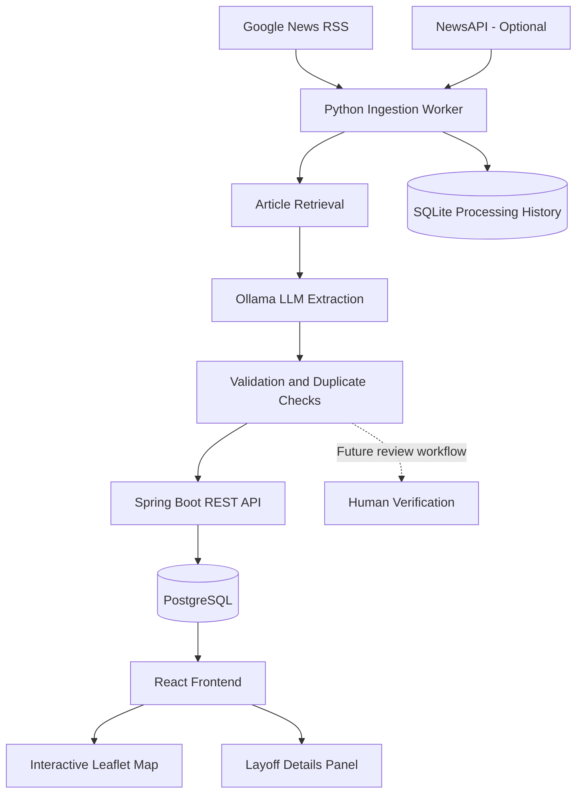

# LayoffsIndia 🇮🇳

### An AI-powered platform for tracking layoffs affecting employees in India.

LayoffsIndia aims to make layoff information more accessible, transparent, and easier to explore. It brings together reported layoff events and presents them through an interactive map, helping users understand which companies are involved, where layoffs are reported, and what information is available from supporting sources.

The project combines a React and TypeScript frontend, a Java Spring Boot backend, PostgreSQL, and a Python-based AI ingestion pipeline powered by Ollama.

> **Project status:** Under active development. The interactive map and core backend APIs are implemented. Automated ingestion, cross-source verification, and the review workflow are being developed incrementally.

---

## Table of Contents

- [Overview](#overview)
- [Features](#features)
- [Architecture](#architecture)
- [Technology Stack](#technology-stack)
- [Project Structure](#project-structure)
- [Getting Started](#getting-started)
- [Configuration](#configuration)
- [API Endpoints](#api-endpoints)
- [Automated Ingestion Pipeline](#automated-ingestion-pipeline)
- [Data Quality and Verification](#data-quality-and-verification)
- [Roadmap](#roadmap)
- [Contributing](#contributing)
- [Disclaimer](#disclaimer)
- [License](#license)

---

## Overview

Layoff information is often scattered across news publications and other online sources. Reported figures can differ, and the actual location of affected employees is not always clear.

LayoffsIndia aims to address this problem by creating a centralized platform where reported layoff events can be explored geographically and investigated through their supporting sources.

The project focuses on three core objectives:

- **Discover:** Find reports about layoffs affecting employees in India.
- **Structure:** Extract useful information from unstructured reports and organize it into a consistent data model.
- **Explore:** Present available information through an interactive map and detailed event views.

The long-term goal is to build a reliable, continuously updated dataset rather than simply aggregate headlines.

## Features

### 🗺️ Interactive Layoff Map

- Explore reported layoff events across India.
- View company markers on an interactive map.
- Select markers to inspect corresponding event details.
- Distinguish confirmed layoff locations from approximate company-office locations.
- Display geographic information using Leaflet and OpenStreetMap.

### 🏢 Layoff Event Tracking

Each record can contain:

- Company name
- Number of employees affected
- Country and reported location
- Company headquarters
- Reported layoff date
- Reason for layoffs
- Supporting source URLs
- Verification status
- Location classification and geographic coordinates

Unknown information is represented as unavailable rather than treated as confirmed fact.

### 🤖 AI-Assisted News Ingestion

The Python ingestion worker is designed to reduce the manual effort involved in finding and organizing layoff reports.

The initial pipeline includes:

- Google News RSS discovery.
- Optional NewsAPI integration.
- Google News URL resolution.
- Article text extraction.
- Structured information extraction using a locally running Ollama model.
- Basic validation of extracted data.
- SQLite-based processing history.
- Candidate submission through the Spring Boot REST API.

Candidates are intended to remain `UNVERIFIED` until reviewed.

### 📍 Location Awareness

A company's headquarters is not necessarily the location where employees were affected.

LayoffsIndia distinguishes between:

- `CONFIRMED`: The affected location is supported by available evidence.
- `OFFICE_REFERENCE`: A company-office location is available, but the actual layoff location is not established.
- `UNKNOWN`: The location cannot currently be determined.

### 🔎 Source Traceability

Layoff records can retain source URLs so that users and reviewers can consult the original reports.

AI-generated information is treated as extracted data, not independent proof that a layoff occurred.

---

## Architecture



### Frontend

The frontend provides the interface for exploring layoff events.

It communicates with the backend through REST APIs and displays available records on an interactive map.

### Backend

The Spring Boot backend exposes APIs for retrieving layoff records and map data, retrieving individual records, and creating records.

It handles application-level validation and persistence to PostgreSQL.

### Ingestion Worker

The Python worker discovers articles, retrieves their content, invokes Ollama for structured extraction, and submits eligible candidates through the backend API.

It uses SQLite to maintain local processing history.

The ingestion worker runs separately from the backend and frontend.

---

## Technology Stack

| Component | Technologies |
|---|---|
| Frontend | React, TypeScript, Vite |
| Interactive maps | Leaflet, React Leaflet, OpenStreetMap |
| Data fetching | TanStack Query |
| Backend | Java, Spring Boot |
| Database | PostgreSQL |
| Database migrations | Flyway |
| ORM | Spring Data JPA, Hibernate |
| Ingestion worker | Python |
| AI inference | Ollama, Qwen 2.5 |
| Structured extraction | Pydantic |
| News discovery | Google News RSS, optional NewsAPI |
| Article extraction | Trafilatura, BeautifulSoup |
| Worker state | SQLite |
| Local development | Docker Compose, Maven Wrapper, Python virtual environments |

---

## Project Structure

```text
LayoffsIndia.fyi/
├── backend/
│   ├── src/
│   │   └── main/
│   │       ├── java/
│   │       │   └── ...
│   │       └── resources/
│   │           ├── application.properties
│   │           └── db/
│   │               └── migration/
│   ├── pom.xml
│   └── mvnw
│
├── frontend/
│   ├── src/
│   │   ├── app/
│   │   ├── components/
│   │   ├── features/
│   │   │   └── layoffs/
│   │   └── lib/
│   ├── .env.example
│   └── package.json
│
├── ingestion-worker/
│   ├── app/
│   │   ├── __init__.py
│   │   ├── config.py
│   │   ├── feeds.py
│   │   ├── extractor.py
│   │   ├── persistence.py
│   │   └── main.py
│   ├── data/
│   ├── .env.example
│   └── requirements.txt
│
├── docker-compose.yml
└── README.md
```

*Adjust the directory names to match your actual repository layout.*

---

## Getting Started

### Prerequisites

Install the following tools:

- Git
- Java 21
- Docker Desktop with Docker Compose
- Node.js and npm
- Python 3.11 or a compatible version
- Ollama

The initial ingestion configuration uses the `qwen2.5:7b` model.

### 1. Clone the repository

```bash
git clone <YOUR_GITHUB_REPOSITORY_URL>
cd LayoffsIndia.fyi
```

### 2. Start PostgreSQL

From the repository root, run:

```bash
docker compose up -d
```

Verify that the database container is running:

```bash
docker compose ps
```

Ensure your Docker Compose configuration and backend datasource settings use matching database credentials.

### 3. Start the Spring Boot backend

Open a terminal in the backend directory:

```bash
cd backend
```

**Windows PowerShell:**

```powershell
.\mvnw.cmd spring-boot:run
```

**macOS or Linux:**

```bash
./mvnw spring-boot:run
```

The backend uses Flyway for database schema migrations.

The default local API base URL is:

```text
http://localhost:8080/api/v1
```

### 4. Start the frontend

Open another terminal:

```bash
cd frontend
npm install
```

Create a `.env` file in the frontend directory:

```dotenv
VITE_API_BASE_URL=http://localhost:8080/api/v1
```

Start the development server:

```bash
npm run dev
```

Open the URL printed by Vite, usually:

```text
http://localhost:5173
```

### 5. Set up Ollama

Install Ollama from [ollama.com/download](https://ollama.com/download).

Download the model:

```bash
ollama pull qwen2.5:7b
```

Verify the model is available:

```bash
ollama list
```

The default local Ollama API URL is:

```text
http://localhost:11434
```

The initial extraction pipeline runs the model locally and does not require an OpenAI API key.

### 6. Set up the ingestion worker

Open another terminal:

```bash
cd ingestion-worker
```

Create a Python virtual environment.

**Windows PowerShell:**

```powershell
py -m venv .venv
.\.venv\Scripts\Activate.ps1
```

**macOS or Linux:**

```bash
python3 -m venv .venv
source .venv/bin/activate
```

Install the dependencies:

```bash
python -m pip install --upgrade pip
pip install -r requirements.txt
```

Create a local `.env` file using `.env.example` as a template.

Example configuration:

```dotenv
OLLAMA_BASE_URL=http://localhost:11434
OLLAMA_MODEL=qwen2.5:7b

LAYOFFS_API_BASE_URL=http://localhost:8080/api/v1

GOOGLE_NEWS_RSS_URL=https://news.google.com/rss/search?q=layoffs+India+when%3A7d&hl=en-IN&gl=IN&ceid=IN%3Aen
NEWSAPI_API_KEY=

MAX_ARTICLES_PER_RUN=20
MIN_ARTICLE_TEXT_LENGTH=200
REQUEST_TIMEOUT_SECONDS=120

SQLITE_PATH=data/ingestion.sqlite3
DRY_RUN=true
```

NewsAPI is optional. If enabled, provide a valid API key.

Run the worker:

```bash
python -m app.main
```

Ensure the backend, PostgreSQL, and Ollama are running before testing the complete pipeline.

**Keep `DRY_RUN=true` during initial testing.** This lets you inspect extracted candidates without submitting them to the backend.

Article retrieval depends on publisher accessibility and page structure. Some websites may block automated requests or expose only a summary, so successful discovery does not guarantee successful extraction.

---

## Configuration

### Frontend

| Variable | Purpose |
|---|---|
| `VITE_API_BASE_URL` | Base URL for the backend API |

### Ingestion Worker

| Variable | Purpose |
|---|---|
| `OLLAMA_BASE_URL` | Local Ollama API URL |
| `OLLAMA_MODEL` | Model used for extraction |
| `LAYOFFS_API_BASE_URL` | Spring Boot API base URL |
| `GOOGLE_NEWS_RSS_URL` | RSS search URL |
| `NEWSAPI_API_KEY` | Optional NewsAPI key |
| `MAX_ARTICLES_PER_RUN` | Maximum number of articles processed per run |
| `MIN_ARTICLE_TEXT_LENGTH` | Minimum article text length |
| `REQUEST_TIMEOUT_SECONDS` | HTTP request timeout |
| `SQLITE_PATH` | Location of the worker's SQLite database |
| `DRY_RUN` | Controls whether candidates are submitted to the backend |

### Backend

Configure database connectivity through the backend's application configuration or environment variables.

Example:

```properties
spring.datasource.url=jdbc:postgresql://localhost:5432/india_layoffs
spring.datasource.username=${DB_USERNAME}
spring.datasource.password=${DB_PASSWORD}
spring.jpa.hibernate.ddl-auto=validate
spring.jpa.open-in-view=false
spring.flyway.enabled=true
```

Supply the database credentials through your local environment or a suitable development configuration. Never commit secrets to GitHub.

---

## API Endpoints

The backend currently provides the following core endpoints:

| Method | Endpoint | Description |
|---|---|---|
| `GET` | `/api/v1/layoffs` | Retrieve layoff records |
| `GET` | `/api/v1/layoffs/map` | Retrieve records intended for map display |
| `GET` | `/api/v1/layoffs/{id}` | Retrieve a specific layoff record |
| `POST` | `/api/v1/layoffs` | Create a layoff record |

Example request:

```http
GET http://localhost:8080/api/v1/layoffs
```

Refer to the backend request and response DTOs for the exact API schemas.

---

## Automated Ingestion Pipeline

The intended ingestion workflow is:

1. **Discover articles:** Retrieve relevant reports from RSS feeds and configured news sources.
2. **Resolve source URLs:** Convert Google News RSS links to publisher URLs where possible.
3. **Extract content:** Download readable article text, with an RSS-summary fallback.
4. **Extract structured fields:** Ask Ollama to produce structured layoff information.
5. **Validate:** Check the output schema and apply basic business rules.
6. **Check duplicates:** Compare URLs with worker processing history and sources already stored in LayoffsIndia.
7. **Create a candidate:** Submit eligible data through the Spring Boot API when dry-run mode is disabled.
8. **Review:** Keep candidates unverified until their details have been reviewed.

### Why Ollama?

Ollama allows the extraction model to run locally, avoiding the need for a hosted LLM API in the initial workflow. It also makes it easier to experiment with different local models.

Local inference does not guarantee factual accuracy. Extracted details must still be checked against their sources.

### Why SQLite?

SQLite stores the worker's local processing history. PostgreSQL remains the primary application database.

### Current Limitations

- Duplicate detection is primarily URL-based rather than event-based.
- Multiple reports of the same event are not yet reliably consolidated.
- Publisher access restrictions can prevent full article extraction.
- Extracted information may be incomplete or incorrect.
- Automated confidence scoring and cross-source verification are not yet complete.
- A dedicated review interface and production scheduling remain future work.

---

## Data Quality and Verification

LayoffsIndia aims to distinguish reported claims from verified information.

Two status fields serve different purposes:

- `verificationStatus` describes whether the layoff event has been verified.
- `locationStatus` describes how confidently its geographic location is established.

A record can remain `UNVERIFIED` even when its location is known. Similarly, a verified event may still have an unknown precise location.

The ingestion worker is designed to create candidates with:

```text
verificationStatus = UNVERIFIED
locationStatus = UNKNOWN
```

A model-generated extraction should never automatically be treated as confirmation that a layoff occurred.

---

## Roadmap

- [x] Build the initial Spring Boot backend and REST APIs.
- [x] Create the PostgreSQL schema and Flyway migrations.
- [x] Build the React frontend with an interactive map.
- [x] Integrate map markers, event details, and location classifications.
- [x] Establish the Python ingestion-worker structure.
- [x] Add initial RSS discovery and Google News URL resolution.
- [x] Integrate Ollama for structured extraction.
- [ ] Complete end-to-end ingestion of real articles.
- [ ] Improve article retrieval for publishers with restricted access.
- [ ] Implement event-level deduplication across sources.
- [ ] Consolidate multiple source URLs into one layoff event.
- [ ] Add evidence tracking and confidence classification.
- [ ] Implement a manual review and confirmation workflow.
- [ ] Improve retries, error handling, and observability.
- [ ] Add scheduled ingestion and monitoring.
- [ ] Expand source coverage and geographic resolution.
- [ ] Add filters and analytics for exploring layoff trends.

---

## Contributing

Contributions, suggestions, and bug reports are welcome.

1. Fork the repository.
2. Create a feature branch.
3. Make your changes and test them locally.
4. Submit a pull request describing the change and its motivation.

For ingestion-related changes, include examples of source material and expected extracted output whenever possible.

Please do not commit secrets, API keys, local databases, or personal credentials.

---

## Disclaimer

LayoffsIndia is an independent project intended to organize and explore publicly reported layoff information.

Information displayed on the platform may be incomplete, delayed, disputed, or inaccurate. A report appearing in the dataset does not automatically establish that every reported detail is correct.

Users should consult original sources before relying on a claim. Map markers may represent company-office locations rather than confirmed locations of affected employees.

LayoffsIndia is not affiliated with the companies, publishers, or organizations whose information may appear in its dataset.

## License

A license has not yet been specified. Add a `LICENSE` file and update this section when you decide how others may use, modify, and distribute the project.
